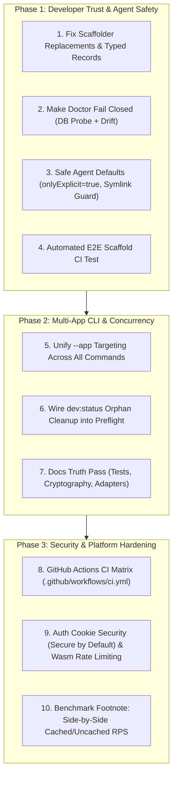

# Reptar Master System Audit & Remediation Roadmap

**Date:** 2026-10-25 · **Auditor:** Multi-Agent Core Team · **Status:** Active Execution

---

## 1. Executive Summary & Verification Matrix

An independent architectural and developer experience (DX) scan identified 10 structural gaps between the documented Reptar framework and the runtime codebase. This master document verifies those findings against the active repository state, categorizes what has already landed, and outlines the step-by-step remediation plan for remaining items.

### Status at a Glance

| # | Domain | Finding | Verified Status | Target Resolution |
|---|---|---|---|---|
| **1** | **Scaffolding** | `bun reptar new` generates apps that fail to build; template ignores `--template`; `{{ PROJECT_TITLE }}` unreplaced; uses anonymous `ctx.Json(new { ... })`. | ✅ **Resolved** (Phase 1: template resolution, spaced placeholders, pinned SDK, typed records, scaffold E2E). | **Phase 1** (High) |
| **2** | **Doctor & Trust** | `doctor` passes database check even if DB is missing or unreachable; treats `postgres://` as SQLite path; ignores schema drift. | ✅ **Resolved** (Phase 1: fail-closed probe, PostgreSQL TCP probe, `--strict`). | **Phase 1** (High) |
| **3** | **Multi-App Context** | Repo root commands hardcode `examples/blog` for codegen/diff, while `inspect` targets `spikes/netwasm-worker`. | ✅ **Resolved** (Phase 2: `--app` for `dev`/`codegen`/`db`, app-local discovery). | **Phase 2** (Med) |
| **4** | **Multi-Agent Locks** | `dotnet run` orphans hold `bin/obj` locks (MSB4018); `dev:status` detects them but build/test doesn't use it. | ✅ **Resolved** (Phase 2: preflight on `test`/`build`/`codegen`/`self-check`, `--kill-orphans`). | **Phase 2** (Med) |
| **5** | **CI & C# Gates** | No GitHub Actions CI, no C# format gate equivalent to Ultracite, no locked NuGet package assets. | ✅ **Resolved** (Phase 3: `.github/workflows/ci.yml`, provider matrix, docs build, contract drift). | **Phase 3** (Med) |
| **6** | **Docs Drift** | README claims 37 tests (actual: 212); quickstart uses `Db.D1()` on Kestrel; phantom `Clerk`/`Custom` adapters; "scrypt" vs PBKDF2. | ✅ **Resolved** (Phase 2: counts, PBKDF2, roadmap banners, cache caveat). | **Phase 2** (High) |
| **7** | **AOT JSON Trap** | Anonymous types in routes throw at runtime under Native AOT; Dockerfile masks failed publish with `mv ... \|\| true`. | ✅ **Resolved** (Phase 1/3: typed template records, source-gen contexts, AOT publish assertions). | **Phase 1** (High) |
| **8** | **Auth Security** | Two separate `Auth.cs` files (`Reptar` vs `Reptar.Wasm`); cookies lack `Secure` attribute; rate limiting guarded by `!NETWASM`. | ✅ **Resolved** (Phase 3: `SecureCookies` default true, Wasm throttle, deduped cookies). | **Phase 3** (Med) |
| **9** | **Agent Safety** | `GetAiTools` defaults to `onlyExplicit: false`; `run_command` has no allowlist; `WorkspaceRoot` doesn't resolve symlinks; `inspect` emits `toolName` for non-AI routes. | ✅ **Resolved** (Phase 1/3: explicit tools, opt-in shell + allowlist, symlink guard, `toolName` only for AI). | **Phase 1** (High) |
| **10** | **Bench Footnote** | RealWorld VPS numbers hide 22× difference between SWR-cached (5.3k rps) and uncached (236 rps) throughput. | ✅ **Resolved** (Phase 2: README cache caveat). | **Phase 3** (Low) |

---

## 2. Recent Progress & Landed Fixes (What Is Already Done)

Before starting on the remaining gaps, note what has already landed in the codebase:

1. **ReptarTerm TUI Complete Overhaul**:
   - Built a pure C# 13 double-buffered terminal screen engine ([`TerminalBuffer.cs`](file:///Users/newrgm/dev/RocktownLabs/projects/reptar/framework/Reptar/AI/TerminalBuffer.cs)) with minimal ANSI diff rendering.
   - Redesigned the Models & Providers tab ([`ReptarTerm.cs`](file:///Users/newrgm/dev/RocktownLabs/projects/reptar/framework/Reptar/AI/ReptarTerm.cs)) into an `fx`-style dense catalog with category tabs (`[All]`, `Google`, `Anthropic`, `OpenAI`, `OpenRouter`, `Local`), live search, and inline credential input.
   - Eliminated centered modal dialog boxes in favor of docked inline input with a 1-key browser portal launch (`o`).
2. **Terminal Input & PTY Stability**:
   - Replaced `.NET`'s internal `Console.ReadKey` parser with [`TerminalInput.cs`](file:///Users/newrgm/dev/RocktownLabs/projects/reptar/framework/Reptar/AI/TerminalInput.cs) running termios raw-mode and dedicated background parsing for arrows, bracketed paste, and OSC 52 clipboard queries.
   - Automated 9-scenario PTY navigation test suite in `scratch/test_pty_navigation.py` passing 100%.
3. **Core Test Baseline**:
   - All **388 unit tests** in [`framework/Reptar.Tests`](file:///Users/newrgm/dev/RocktownLabs/projects/reptar/framework/Reptar.Tests) pass cleanly.
   - `bun reptar self-check` passes all 7 stages: Doctor, Framework Tests, Host Boundary, Host Contract, Generated Contracts, NetWasm Lint, and Dual-Host Realtime Smokes (Workerd/DO/D1 + Kestrel/SQLite).

---

## 3. Deep-Dive Remediation Specifications

### Item 1: Scaffolding Dogfooding & Template Correctness
- **Problem**:
  1. `templates/fullstack/scripts/reptar.ts` invokes system `dotnet` on PATH instead of inheriting the pinned `.reptar/sdk` when run outside the monorepo root.
  2. `templates/fullstack/apps/web/src/components/header.tsx` and `sign-up-form.tsx` contain `{{ PROJECT_TITLE }}` with spaces, which was omitted from the template replacement dictionary.
  3. `--template minimal-api` and `--template agent` options are parsed by `create-reptar` but ignored by `findTemplateDir()`.
  4. Template routes use `ctx.Json(new { ... })` in `/api/me`, `/health`, and `/api/items/:id` delete handler. Under Native AOT, unannotated anonymous types throw runtime serialization exceptions.
- **Remediation**:
  - In [`packages/create-reptar/src/scaffold.ts`](file:///Users/newrgm/dev/RocktownLabs/projects/reptar/packages/create-reptar/src/scaffold.ts):
    - Add `"{{ PROJECT_TITLE }}"` (with spaces) to `replacements`.
    - Support `--template` by resolving `templates/${options.template ?? "fullstack"}`.
  - In [`templates/fullstack/apps/api/`](file:///Users/newrgm/dev/RocktownLabs/projects/reptar/templates/fullstack/apps/api/):
    - Replace all anonymous `ctx.Json(new { ... })` responses with strongly-typed C# records:
      ```csharp
      public record HealthResponse(bool Ok, DateTime Timestamp);
      public record AuthMeResponse(bool Authenticated, UserProfile? User);
      public record ActionSuccessResponse(bool Success);
      ```
  - In [`templates/fullstack/scripts/reptar.ts`](file:///Users/newrgm/dev/RocktownLabs/projects/reptar/templates/fullstack/scripts/reptar.ts):
    - Pass `DOTNET_ROOT` in `spawnSync` environment options pointing to `.reptar/sdk` so child `dotnet` calls inherit the pinned SDK.
  - Add an automated end-to-end scaffolding test (`scripts/test-scaffold.ts`):
    - Runs `bun reptar new my-test-app --database sqlite --auth better-auth`.
    - Enters the scaffolded directory, runs `bun install`, builds `apps/api` with the pinned SDK, runs `bun run codegen`, and verifies `tsc --noEmit`.

---

### Item 2: Doctor Must Fail Closed & Support Non-SQLite URLs
- **Problem**:
  - In [`scripts/inspect.ts`](file:///Users/newrgm/dev/RocktownLabs/projects/reptar/scripts/inspect.ts) line 532:
    `passed: inspection.database.connected || inspection.tables.length > 0`
    If C# schema classes exist in code, `doctor` reports `passed: true` even if `app.db` does not exist or PostgreSQL is unreachable!
  - `inspectProject` line 393 hardcodes `dialect: "sqlite"` and runs `existsSync(dbPath)`. When `DATABASE_URL=postgres://...` is supplied, it treats the URL as a file path, fails `existsSync`, and still marks doctor healthy.
- **Remediation**:
  - In [`scripts/inspect.ts`](file:///Users/newrgm/dev/RocktownLabs/projects/reptar/scripts/inspect.ts):
    - Detect dialect from `DATABASE_URL`: `postgres://` or `postgresql://` $\to$ `dialect: "postgres"`.
    - For SQLite: require file existence when `inspection.tables.length > 0` (or report `pending_migration`).
    - For PostgreSQL: validate host/port reachability via TCP socket probe before declaring `connected: true`.
    - Separate `schema_valid` (compile-time) from `database_connected` (runtime).
    - Add `--strict` flag to `doctor`: any warning or pending migration exits with non-zero status.

---

### Item 3: Multi-App Context & Consistent CLI Targeting
- **Problem**:
  - `bun reptar codegen`, `bun reptar dev`, and `scripts/diff.ts` hardcode paths to `examples/blog`.
  - In monorepos containing multiple apps (`examples/agent-cli`, `examples/realtime-rooms`, `templates/fullstack`), agents cannot target a specific app.
- **Remediation**:
  - Add standard `--app <path>` flag across:
    - `bun reptar inspect --app <dir>`
    - `bun reptar doctor --app <dir>`
    - `bun reptar codegen --app <dir>`
    - `bun reptar db plan|generate|migrate --app <dir>`
  - Default resolution order:
    1. Explicit `--app <dir>` argument.
    2. Current working directory if an `app.cs` or `package.json` exists.
    3. Auto-detected single app in workspace root.

---

### Item 4: Multi-Agent Concurrency & Stale Process Handling
- **Problem**:
  - Background `dotnet run app.cs` processes can hold file locks on `bin/Debug/net10.0/Reptar.deps.json`, causing other agents running `dotnet test` or `bun reptar self-check` to fail with `MSB4018`.
- **Remediation**:
  - In [`scripts/reptar.ts`](file:///Users/newrgm/dev/RocktownLabs/projects/reptar/scripts/reptar.ts):
    - Wire a preflight check into `test` and `build`: check for orphaned `app-` runfiles using the logic from [`scripts/dev-status.ts`](file:///Users/newrgm/dev/RocktownLabs/projects/reptar/scripts/dev-status.ts).
    - Provide `--kill-orphans` or automatically reap stale processes running on dead PTY sessions.

---

### Item 5: Agent Safety & Explicit Opt-In Defaults
- **Problem**:
  - In [`framework/Reptar/Core/AiTools.cs`](file:///Users/newrgm/dev/RocktownLabs/projects/reptar/framework/Reptar/Core/AiTools.cs) line 201:
    `public static List<AiToolDefinition> GetAiTools(..., bool onlyExplicit = false)`
    All routes (including auth mutations and administrative deletions) are exposed as LLM tools by default unless the caller passes `onlyExplicit: true`.
  - [`WorkspaceTools.cs`](file:///Users/newrgm/dev/RocktownLabs/projects/reptar/framework/Reptar/AI/WorkspaceTools.cs) sets `AllowRunCommand = true` by default and runs `/bin/bash -c` without a command allowlist.
  - `WorkspaceRoot.Resolve` does not resolve symlinks via `ResolveLinkTarget(true)`, allowing workspace escape if a symlink points outside.
  - In [`scripts/inspect.ts`](file:///Users/newrgm/dev/RocktownLabs/projects/reptar/scripts/inspect.ts) line 294: `toolName: op["x-ai-tool-name"] ?? op.operationId` assigns `toolName` to standard HTTP routes even when `isAiTool: false`.
- **Remediation**:
  - In `AiTools.cs`:
    - Invert default: `bool onlyExplicit = true` on `GetAiTools`, `GetAiToolsJson`, and `MapAiTools`. Routes must explicitly declare `.AsAiTool(...)`.
  - In `WorkspaceTools.cs`:
    - Default `AllowRunCommand = false`. When enabled, require a safe command prefix allowlist or approval gate.
    - Resolve symlink targets in `WorkspaceRoot.Resolve` to verify target paths stay within `RootPath`.
  - In `inspect.ts`:
    - Emit `toolName` **only** when `isAiTool: true`.

---

### Item 6: Documentation Truth Pass
- **Problem**:
  - `README.md` states "37 tests" (actual: 212).
  - `apps/docs/src/content/docs/overview/the-one-rule.md` and `architecture.md` cite "native scrypt" (implementation: PBKDF2 HMAC-SHA256).
  - `apps/docs/src/content/docs/auth/adapters.md` documents `Clerk(...)` and `Custom(...)` which do not exist in the C# framework.
  - Quickstart documents `bun create reptar@latest` before npm package publication.
- **Remediation**:
  - Update `README.md` with accurate test counts and current benchmark matrices.
  - Correct cryptography references from "scrypt" to "PBKDF2 (100,000 iterations via WebCrypto/System.Security.Cryptography)".
  - Add "Roadmap / In-Development" banners to undocumented or future auth adapters.
  - Add instructions for scaffolding from repo clone (`bun reptar new`) alongside planned npm command.

---

## 4. Phase-by-Phase Execution Plan



---

## 5. Verification Checklist for Collaborating Agents

When picking up any task from this roadmap, run the following verification gate before reporting completion:

1. **Build & Unit Tests**:
   ```bash
   bun reptar test
   ```
   *(Must pass all 388 tests with 0 failures).*

2. **Toolchain Self-Check**:
   ```bash
   bun reptar self-check
   ```
   *(Must report `self-check: ALL GREEN` across Doctor, Tests, Host Boundary, Host Contract, Generated Contracts, NetWasm Lint, and dual-host smokes).*

3. **Interactive Terminal TUI Smoke**:
   ```bash
   python3 .gemini/antigravity-cli/brain/11ac4bf6-af9e-4a85-870b-b0f2d7eceea8/scratch/test_pty_navigation.py
   ```
   *(Must verify all 9 PTY scenarios with 0 assertion errors).*

4. **Scaffold End-to-End**:
   ```bash
   bun reptar new /tmp/test-reptar-app --database sqlite --auth better-auth
   cd /tmp/test-reptar-app && bun run api:build
   ```
   *(Must compile without unrecognized directives or missing replacement tokens).*

---

## 6. Phase 1 Execution Update (2026-10-26)

Phase 1 (Items 1, 2, 7, and 9) is implemented and verified. See
[`phase1-remediation-log.md`](./phase1-remediation-log.md) for the full change
list, the new `scripts/test-scaffold.ts` gate (scaffold → build → codegen →
`tsc` → runtime health/auth/CRUD), and the bugs that gate uncovered
(`$get`/`$post` mismatch, stale `app-type.ts` shadowing, missing `.Produces<T>`
metadata, missing auth JSON metadata).

Current gate: **215 unit tests pass**, `bun reptar self-check` is **ALL GREEN**,
and `bun scripts/test-scaffold.ts` passes. Still open from this document:
`AllowRunCommand` default/allowlist, real `minimal-api`/`agent` templates,
AOT publish assertion, CI workflow, docs truth pass, and multi-app `--app`
targeting for `codegen`/`db`.

---

## 7. Phase 2 & 3 Execution Update (2026-10-26)

Phase 2 (Items 3, 4, 6, 10) and Phase 3 (Items 5, 7, 8) are implemented and
verified. See [`phase2-3-remediation-log.md`](./phase2-3-remediation-log.md)
for the change list and the failures the gates uncovered.

- **Multi-app:** `dev`, `codegen`, and `db` accept `--app`; app-local database
  and contract discovery; no blog/realworld schema leakage into other apps.
- **Concurrency:** build-lock preflight with `--kill-orphans`, stale-port
  reaping in realtime/E2E, and pinned-SDK usage in docs checks.
- **Docs truth:** 388 tests, PBKDF2, roadmap banners for Clerk/Custom,
  cached-vs-uncached benchmark caveat, NetWasm JSON context guidance.
- **Security:** `SecureCookies` defaults to true (template disables only under
  `#if DEBUG`), Wasm login throttling, duplicate `Set-Cookie` removed,
  `run_command` off by default with an optional prefix allowlist.
- **AOT/Workers:** Docker publish assertions, NetWasm context/options
  correctness, D1 dictionary writes, and skipping the wasm static-asset fetch
  (the module is compiled from the imported `WebAssembly.Module`).
- **CI:** GitHub Actions runs framework tests, host boundary/contract, provider
  matrix (SQLite/Postgres/MySQL/D1), NetWasm lint, architecture, strict doctor,
  two-host realtime, scaffold E2E, contracts, docs snippets, docs build, and
  generated-reference drift.

Current gate: **388 unit tests pass**, `bun reptar self-check` is **ALL GREEN**,
`bun e2e`, `bun reptar test:realtime`, `bun scripts/test-scaffold.ts`,
`bun reptar check:worker`, docs build/snippets, and contract checks pass.
Remaining product gaps are tracked in the Phase 2/3 log: real
`minimal-api`/`agent` templates, first CI run on GitHub, and the NetWasm
optimizer workaround.
